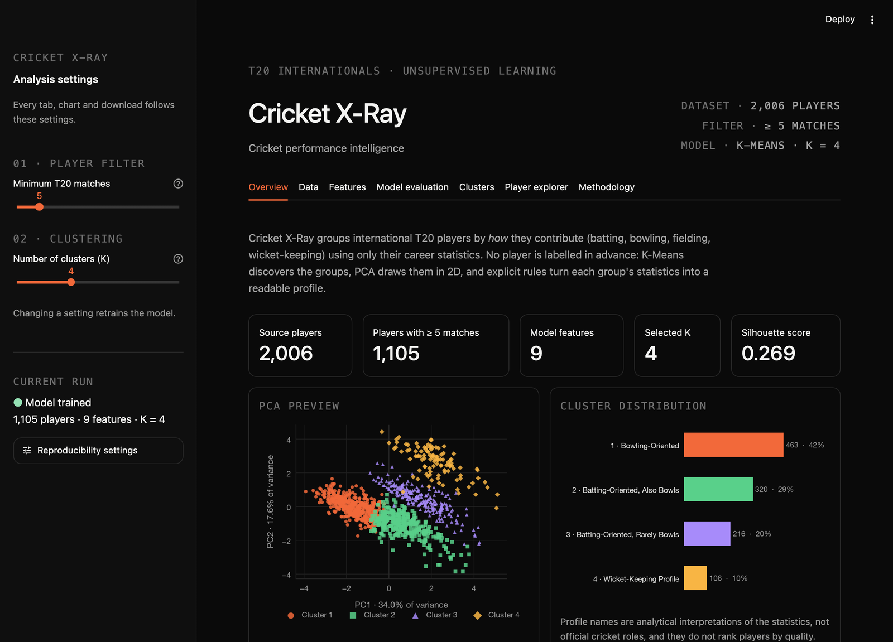
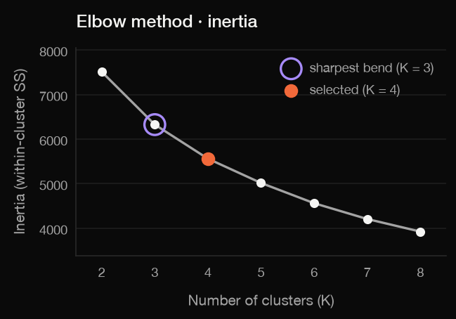
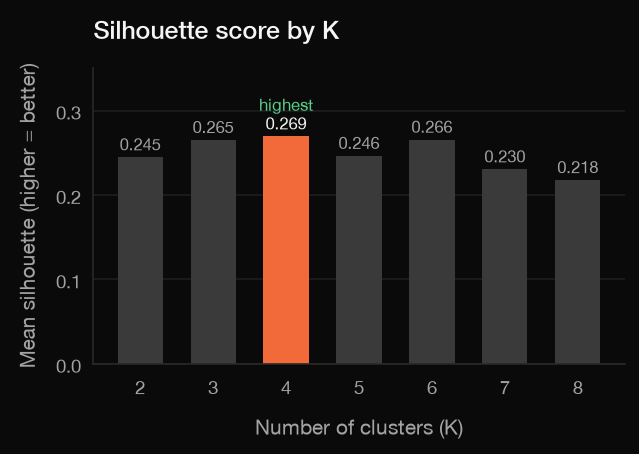
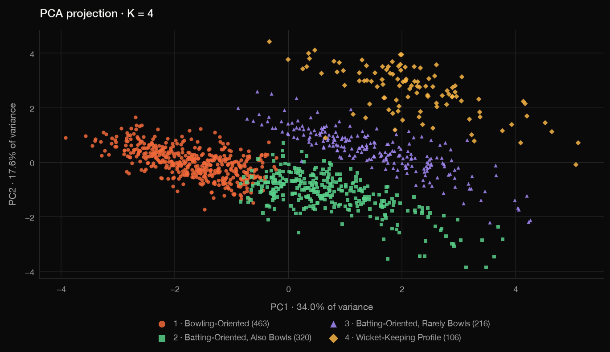
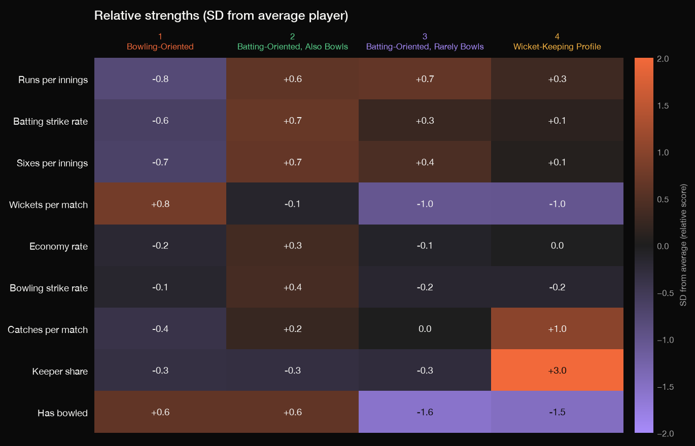

# Cricket X-Ray

**Discovering Cricket Player Performance Profiles Using Unsupervised Machine Learning**

Third-semester Statistical Machine Learning project (B.Tech CSE).



## Problem statement

Players are usually described by fixed roles (batter, bowler, all-rounder,
wicket-keeper), but these roles are informal and many players do several jobs.
Cricket X-Ray asks whether similar **performance profiles can be discovered from
career statistics alone**, without giving the algorithm any labels. It uses
K-Means clustering on engineered T20 international batting, bowling and fielding
features, evaluates the choice of K with the elbow method and silhouette scores,
visualizes the result with PCA, and explains each cluster from its real statistics.

## Features

| Area | What the app does |
|---|---|
| Data | Validates and merges the three T20 CSV files; shows source files, overlap, missing values |
| Feature engineering | Minimum-matches filter; 12 per-innings / per-match features with an explicit missing-value policy |
| Model | Percentile clipping, median imputation, a *has bowled* flag, `StandardScaler`, K-Means (K = 2 to 8, default 4) |
| Evaluation | Elbow chart (inertia) and silhouette chart for every K, with a live interpretation |
| Clusters | PCA scatter plot, PCA loadings, cluster profile cards, real-value profile table, relative-strength heatmap |
| Player explorer | Search any player; source statistics, engineered features, assigned cluster, distance to every cluster centre, 5 nearest players, other cluster members |
| Export | CSV downloads of per-player results and cluster summaries for the current settings |
| Methodology | Viva-style explanation of every step, live imputation details, limitations |

All numbers in the app are computed live from the CSV files; nothing is hardcoded.

## Technology

Python 3.11, pandas, NumPy, scikit-learn, Matplotlib and Streamlit (the five
packages in `requirements.txt`). Tests use Python's built-in `unittest` and
Streamlit's `AppTest`.

## Interface and theme

The dashboard follows a near-black, typography-led design system:

| Token | Value | Used for |
|---|---|---|
| Background / surface / raised | `#0A0A0A` / `#141414` / `#1E1E1E` | page, cards and inputs, chart grid lines |
| Border | `#292929` | card and widget borders |
| Text / muted / subtle | `#F5F5F3` / `#A3A3A3` / `#707070` | body text, secondary text, monospaced labels |
| Accent | `#F2693A` (orange) | selected K, active tab, primary download, PC1 |
| Code green / violet | `#59D08A` / `#A78BFA` | status and "highest" marks, elbow ring, PC2 |

- The theme lives in `.streamlit/config.toml` (colours, local system font
  stacks, heading sizes, rounded buttons). No web fonts are downloaded.
- `app.py` adds a small CSS block (no JavaScript) for the uppercase
  monospaced section labels and the header details.
- `charts.py` repeats the same hex values so Matplotlib charts match the
  interface. Each cluster has a fixed colour **and** marker shape, and labels
  always show the cluster number and name, so colour is never the only cue.
- The layout uses Streamlit's responsive columns: on narrow screens cards
  stack in reading order and wide tables scroll inside their frames.

## Project structure

```
CricketXray/
├── app.py                 # Streamlit dashboard (7 tabs, sidebar settings)
├── data_loader.py         # load_data(): read, validate, clean and merge the CSVs
├── preprocessing.py       # prepare_features(): minimum-matches filter + engineered features
├── modeling.py            # imputation, scaling, K-Means, evaluation, PCA, interpretation
├── charts.py              # Matplotlib charts using the same design tokens as the theme
├── requirements.txt
├── .streamlit/config.toml # design-system theme (colours, fonts, radii)
├── tests/
│   ├── test_data_loader.py
│   ├── test_preprocessing.py
│   ├── test_modeling.py
│   └── test_app.py        # Streamlit AppTest
├── docs/images/           # screenshot and charts used in this README
├── notebooks/
│   └── Cricket_Xray.ipynb # original exploration notebook (unchanged)
├── data/                  # CSV datasets (NOT committed, see below)
└── outputs/               # optional local outputs (not committed)
```

## Dataset requirements

The datasets are **not included in this repository**. Place your own copies here:

| Dataset | Path | Required columns |
|---|---|---|
| Batting | `data/Batting/t20.csv` | `Player, Span, Mat, Inns, NO, Runs, HS, Ave, BF, SR, 100, 50, 0, 4s, 6s` |
| Bowling | `data/Bowling/Bowling_t20.csv` | `Player, Span, Mat, Inns, Overs, Mdns, Runs, Wkts, BBI, Ave, Econ, SR, 4, 5` |
| Fielding | `data/Fielding/Fielding_t20.csv` | `Player, Span, Mat, Inns, Dis, Ct, St, Ct Wk, Ct Fi, MD, D/I` |

These are career tables for T20 internationals in the ESPNcricinfo style, with
one row per player. `Player` includes a country tag such as `V Kohli (INDIA)`, and
`-` marks "did not bat/bowl" or "not defined". Extra columns (for example an
exported `Unnamed: 0` index) are ignored. The same three tables must contain the
same players. The loader checks the files, columns, duplicates and value formats,
and reports a readable error if anything is wrong. If the files are missing, the
app still opens and shows that error.

The copies used during development have 2,006 players in each file.

## Installation

Requires Python 3.11 or 3.12.

### macOS / Linux

```bash
git clone https://github.com/Arjav1512/CricketXray.git
cd CricketXray
python3.11 -m venv .venv
source .venv/bin/activate
pip install -r requirements.txt
```

### Windows (PowerShell)

```powershell
git clone https://github.com/Arjav1512/CricketXray.git
cd CricketXray
py -3.11 -m venv .venv
.venv\Scripts\Activate.ps1
pip install -r requirements.txt
```

If PowerShell blocks the activation script, run
`Set-ExecutionPolicy -Scope CurrentUser RemoteSigned` once, or use Command
Prompt with `.venv\Scripts\activate.bat`.

Then copy the three CSV files into `data/` as shown above.

## Run the app

With the virtual environment activated, from the project folder:

```bash
streamlit run app.py
```

Open **http://localhost:8501**. If that port is busy, Streamlit picks the next free
one (8502, ...) and prints the URL. Stop the server with `Ctrl+C`. After pulling new
code, restart the server so that changed modules are reloaded.

Use the sidebar to set the minimum number of matches and K. Every tab, chart and
download updates to match.

## Run the tests

```bash
python -m unittest discover -s tests -v
```

80 tests: data loading and validation, preprocessing, modeling, and Streamlit
`AppTest` checks. Tests that need the real CSV files are skipped automatically
when the files are missing.

## Features and formulas

Rates are calculated from the count columns, not copied from the file's rounded
rate columns. The tests check that they match the file's `Ave`, `SR` and `Econ`
columns within rounding.

| Feature | Formula | Used in model |
|---|---|---|
| Runs per innings | `Runs_Bat / Inns_Bat` | yes |
| Batting strike rate | `100 × Runs_Bat / BF_Bat` | yes |
| Fours per innings | `4s_Bat / Inns_Bat` | no (almost the same as runs per innings) |
| Sixes per innings | `6s_Bat / Inns_Bat` | yes |
| Batting average | `Runs_Bat / (Inns_Bat − NO_Bat)` | no (strongly tied to runs per innings; undefined if never dismissed) |
| Wickets per match | `Wkts_Bowl / Mat` | yes |
| Economy rate | `Runs_Bowl / (balls / 6)` | yes |
| Bowling average | `Runs_Bowl / Wkts_Bowl` | no (exactly economy × strike rate / 6) |
| Bowling strike rate | `balls / Wkts_Bowl` | yes |
| Catches per match | `Ct_Field / Mat` | yes |
| Stumpings per match | `St_Field / Mat` | no (strongly tied to keeper share) |
| Keeper share | `(Ct Wk + St) / Dis` | yes |
| Has bowled | `1` if the raw bowling innings is above 0 | yes (activity flag) |

**Balls bowled** use cricket notation: `whole_overs × 6 + balls`, so 10.1 → 61 and
10.5 → 65. The app's Methodology tab shows live correlations for the features
that are left out of the model. Those features still appear in profiles,
the player explorer and the downloads.

## Missing-value decisions

1. **Feature engineering keeps undefined rates as missing.** Counts become 0 only
   when the raw innings column is `-`, which means the player never batted, bowled
   or fielded. Rates with a zero denominator stay `NaN`, never 0, because an
   undefined average is not a poor average.
2. **The model input fills them carefully.** This step is fitted on the modeled
   players only.
   - Each continuous feature is clipped to its 1st–99th percentile, so tiny-sample
     extremes (for example an economy of 24) cannot dominate distances.
   - Undefined rates are filled with the feature's **median** over players where the
     rate is defined. A non-bowler therefore gets a typical economy, never an elite one.
   - The **has bowled** flag and 0 wickets per match keep non-bowlers apart from real
     bowlers. The flag is read from the raw innings column and never from filled values.
3. **Cluster profiles always show real, unfilled values** (medians that skip
   undefined values). A median based on fewer than 10 players is shown as `n/a`.

## Machine learning methodology

1. **StandardScaler.** Each feature is rescaled to mean 0 and standard deviation 1.
   Without this, strike rate (around 100) would outweigh wickets per match (around 0.5)
   in every distance calculation.
2. **K-Means.** Places K centres, assigns every player to the nearest one, and moves
   the centres until the within-cluster sum of squares (**inertia**) stops falling.
   Settings: `k-means++` initialization, `n_init=10`, `max_iter=300`, `random_state=42`.
   Clusters are renumbered 1..K from largest to smallest.
3. **Elbow method.** Plots inertia for K = 2 to 8. Inertia always falls as K grows,
   so the "elbow" (the point where improvement slows) is a heuristic. The app marks
   the sharpest bend using the largest second difference.
4. **Silhouette score.** For each player, s = (b − a) / max(a, b), where a is the mean
   distance to its own cluster and b the mean distance to the nearest other cluster.
   The score runs from −1 to 1, and higher means better separated. It is computed on
   all players up to 2,000, and on a seeded sample of 2,000 above that.
5. **PCA.** Two principal components of the same standardized matrix, used only to
   draw the clusters in 2D. The loadings chart shows which features drive each axis.
6. **Interpretation.** Each cluster gets a label from explicit rules on its relative
   profile, for example "batting score at least 0.5 SD above average" gives
   Batting-Oriented. Clusters that match no rule keep a neutral name such as `Cluster 5`.
   The rules are documented in `modeling.interpret_clusters`.

## Results on the development data (default settings)

These results were computed on the copies of the T20 files used during development,
with a minimum of 5 matches and K = 4. Other data or settings will give different
numbers; the app always shows the live values.

- Players modeled: **1,105** of 2,006 (901 have fewer than 5 matches); model features: **9**
- PCA: PC1 explains **34.0%** of the variance, PC2 **17.6%**, **51.6%** combined

| K | 2 | 3 | 4 | 5 | 6 | 7 | 8 |
|---|---|---|---|---|---|---|---|
| Inertia | 7512.2 | 6325.7 | 5561.3 | 5015.6 | 4561.2 | 4206.2 | 3923.7 |
| Silhouette | 0.245 | 0.265 | **0.269** | 0.246 | 0.266 | 0.230 | 0.218 |




The heuristics disagree slightly. The elbow bends most sharply at K = 3, while
the highest silhouette is at K = 4, and K = 3, 4 and 6 score almost the same.
All the scores fall between 0.25 and 0.5, which is conventionally read as **weak
structure**. That is expected, because cricket roles overlap. K = 4 is the default
because it has the best silhouette score and gives four interpretable profiles;
it is not claimed to be optimal.



| Cluster | Label | Players | Runs / inns | Bat SR | Wkts / match | Economy | Catches / match | Keeper share | Bowled |
|---|---|---|---|---|---|---|---|---|---|
| 1 | Bowling-Oriented | 463 | 4.50 | 85.71 | 1.00 | 7.28 | 0.20 | 0.00 | 100% |
| 2 | Batting-Oriented, Also Bowls | 320 | 17.20 | 126.27 | 0.40 | 7.90 | 0.33 | 0.00 | 100% |
| 3 | Batting-Oriented, Rarely Bowls | 216 | 18.17 | 114.07 | 0.00 | n/a | 0.30 | 0.00 | 0% |
| 4 | Wicket-Keeping Profile | 106 | 14.03 | 111.68 | 0.00 | n/a | 0.51 | 1.00 | 5% |

Values are medians of the real statistics. `n/a` means fewer than 10 players in
the cluster have bowled, so no reliable economy can be given.



## How to interpret the results

- A **cluster** is a group of players with similar *statistical* profiles. Labels
  are analytical interpretations, not official roles, and they do **not** rank
  players or predict future performance.
- The **profile table** shows real cricket statistics. The **heatmap** shows
  *relative* scores in standard deviations: a value of −1 for economy means a lower
  (better) economy than average, not a negative economy.
- In the **PCA plot**, nearby points have similar profiles. Some overlap is
  expected, because the plot keeps only about half the variance.
- The **player explorer** shows each player's distance to every cluster centre,
  which explains their assignment. It also lists their 5 nearest neighbours by
  Euclidean distance in the same standardized space.

## Limitations

- Career totals cannot capture batting position, era, opposition or recent form.
- Median filling makes non-bowlers look like typical bowlers on economy and strike
  rate. The *has bowled* flag and wickets per match offset this, but not perfectly.
- *Has bowled* counts any bowling at all, so part-time bowlers count as bowlers.
- K-Means assumes compact, similar-sized clusters, so overlapping roles give modest
  silhouette scores.
- Players with very few matches are excluded (default threshold 5), which is a
  practical choice rather than a statistically optimal one.
- The data is a historical snapshot and is not part of this repository.

## Reproducibility

| Setting | Value |
|---|---|
| Random state | 42 (K-Means and silhouette sampling) |
| K-Means | `k-means++`, `n_init=10`, `max_iter=300` |
| Default K / range | 4 / 2 to 8 |
| Minimum matches | 5 by default (adjustable, 1 to 30) |
| Clipping | 1st to 99th percentile, fitted on modeled players |
| Imputation | median, fitted on modeled players |
| Scaling | `StandardScaler` |
| PCA | 2 components, full SVD |

The same data and settings always give the same clusters (this is tested). The
app's sidebar shows these settings under *Reproducibility settings*. No model file
is saved; the model is retrained (and cached) when settings change.

## Implementation status

| Stage | Status |
|---|---|
| Data loading and validation | Done |
| Preprocessing and feature engineering | Done |
| Imputation and feature scaling | Done |
| K-Means clustering | Done |
| Elbow and silhouette evaluation | Done |
| PCA visualization | Done |
| Cluster interpretation and player explorer | Done |
| Result export | Done |
| Tests | 80 `unittest` / `AppTest` tests |

Possible future work: add the ODI and Test files, try Gaussian mixture models or
hierarchical clustering, or use ball-by-ball data to capture batting position and
phase of play.

The original notebook in `notebooks/` is kept unchanged as the starting point of the project.
