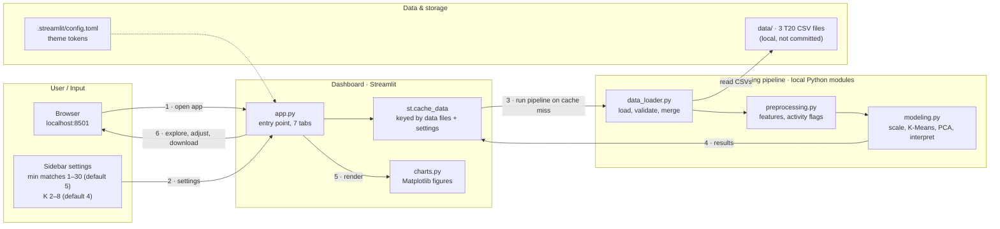
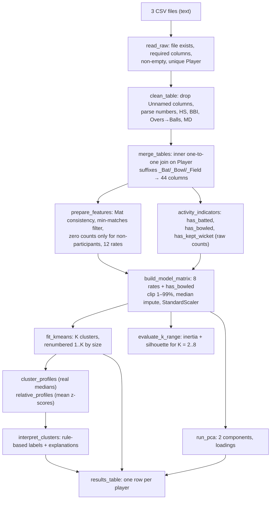

# Cricket X-Ray — Project Report

**Discovering Cricket Player Performance Profiles Using Unsupervised Machine Learning**

| | |
|---|---|
| **Project** | Cricket X-Ray |
| **Context** | Third-semester Statistical Machine Learning project, B.Tech Computer Science and Engineering |
| **Repository** | [github.com/Arjav1512/CricketXray](https://github.com/Arjav1512/CricketXray) |
| **Snapshot reviewed** | `main` at commit `abb537b` (30 October 2026) |
| **Domain** | Sports analytics: T20 International (T20I) cricket |
| **Techniques** | Feature engineering, median imputation, standardization, K-Means clustering, elbow method, silhouette analysis, Principal Component Analysis (PCA), rule-based cluster interpretation |
| **Stack** | Python 3.11/3.12, pandas, NumPy, scikit-learn, Matplotlib, Streamlit |
| **Deliverable** | An interactive Streamlit dashboard backed by a tested, modular Python pipeline |

---

## Abstract

Cricket players are conventionally described by fixed roles such as batter, bowler, all-rounder and wicket-keeper. These roles are informal, inconsistently applied, and many players perform several of them. Cricket X-Ray investigates whether meaningful *performance profiles* can be discovered from career statistics alone, without supplying the algorithm with any role labels.

The system ingests three ESPNcricinfo-style career tables for T20 Internationals (batting, bowling and fielding), validates and merges them into one row per player, and engineers twelve per-innings and per-match features under an explicit missing-value policy. A model-input stage clips extreme values, imputes undefined rates with medians, adds a *has bowled* activity flag and standardizes the result. K-Means then groups players, with the number of clusters guided by the elbow method and silhouette scores, and PCA projects the clusters into two dimensions for visualization. Explicit, documented rules translate each cluster's statistics into a readable label.

On the development data (2,006 players; 1,105 modeled with at least 5 matches; K = 4), the system discovers four interpretable profiles: **Bowling-Oriented**, **Batting-Oriented, Also Bowls**, **Batting-Oriented, Rarely Bowls** and **Wicket-Keeping Profile**, with a mean silhouette of **0.269**. That score indicates weak but real structure, which is expected because cricket roles overlap. Everything is exposed through a seven-tab dashboard whose every number is computed live, and the codebase is covered by 80 automated tests run in GitHub Actions.

---

## Table of Contents

1. [Introduction](#1-introduction)
2. [Objectives](#2-objectives)
3. [Scope](#3-scope)
4. [Dataset](#4-dataset)
5. [System Architecture](#5-system-architecture)
6. [Implementation](#6-implementation)
7. [Results](#7-results)
8. [Testing and Quality Assurance](#8-testing-and-quality-assurance)
9. [Reproducibility](#9-reproducibility)
10. [Technology Stack](#10-technology-stack)
11. [Installation and Usage](#11-installation-and-usage)
12. [Project Structure](#12-project-structure)
13. [Limitations](#13-limitations)
14. [Review Observations and Recommendations](#14-review-observations-and-recommendations)
15. [Future Work](#15-future-work)
16. [Conclusion](#16-conclusion)
17. [Appendices](#appendices)

---

## 1. Introduction

### 1.1 Background

In T20 cricket each side faces at most 20 overs, which places a premium on scoring speed (batting strike rate), boundary hitting, wicket-taking and run containment (bowling economy). Team selection and commentary describe players with a small vocabulary of roles, yet many players occupy several roles at once: batters who bowl a few overs, bowlers who contribute with the bat, and wicket-keepers who are also front-line batters. These labels are not recorded in the standard statistical tables and are applied subjectively.

### 1.2 Problem Statement

> Can groups of players with similar performance profiles be *discovered* from T20 International career statistics alone, without providing role labels, and can those groups be explained in cricket terms?

### 1.3 Why Unsupervised Learning

There is no trustworthy label column to learn from: roles are informal, change over a career, and overlap. A supervised classifier would therefore learn the biases of whoever produced the labels. Clustering instead groups players purely by the similarity of their numbers, and the groups are interpreted afterwards using the real statistics of their members. This turns the role question from an assumption into an empirical finding.

---

## 2. Objectives

The primary objective is to build a transparent, reproducible pipeline that clusters T20I players by statistical profile and explains each cluster. The specific objectives, and where each is met in the codebase, are:

| # | Objective | Where it is implemented | Status |
|---|---|---|---|
| O1 | Load, validate and merge the three source tables into one row per player, failing loudly on malformed data | `data_loader.py` | Done |
| O2 | Engineer comparable per-innings / per-match features with a principled treatment of undefined values | `preprocessing.py` | Done |
| O3 | Prepare a clean, scaled model input (clipping, imputation, activity flag, standardization) | `modeling.build_model_matrix` | Done |
| O4 | Cluster players with K-Means using reproducible settings | `modeling.fit_kmeans` | Done |
| O5 | Evaluate the choice of K with the elbow method and silhouette scores | `modeling.evaluate_k_range`, `elbow_heuristic`, `silhouette` | Done |
| O6 | Visualize clusters in 2D with PCA and expose the feature loadings | `modeling.run_pca`, `charts.py` | Done |
| O7 | Interpret clusters with explicit, documented rules based on real statistics | `modeling.interpret_clusters`, `cluster_profiles` | Done |
| O8 | Provide an interactive dashboard with player-level explanations and CSV export | `app.py` | Done |
| O9 | Verify correctness with automated tests and continuous integration | `tests/`, `.github/workflows/tests.yml` | Done (80 tests) |

---

## 3. Scope

### 3.1 In Scope

The project covers T20 International career statistics for batting, bowling and fielding; data validation and cleaning; feature engineering; K-Means clustering with K from 2 to 8; model evaluation; PCA visualization; rule-based cluster labelling; a player explorer with nearest-centre and nearest-neighbour explanations; CSV export of results; and a locally run Streamlit dashboard.

### 3.2 Out of Scope

The following are deliberately excluded:

- **Prediction or ranking.** Cluster labels describe statistical style; they do not rank player quality or forecast future performance.
- **Other formats.** ODI and Test data are not used (listed as future work).
- **Contextual data.** Batting position, match phase, era, opposition strength and recent form are not available in career totals.
- **Persistence and deployment.** There is no database, user login, external API, cloud hosting or saved model file. Results live in memory and the model is retrained (and cached) whenever settings change.
- **Data distribution.** The source CSV files are not part of the repository.

### 3.3 Assumptions

- The three tables describe the same population of players, keyed by the full `Player` string including its country tag (for example `V Kohli (INDIA)`), which disambiguates players who share a name.
- The match count (`Mat`) for a player is identical across the three tables; the pipeline checks this and raises an error otherwise.
- A minimum-matches threshold (default 5) is a practical filter against profiles built on one or two games, not a statistically optimal value.

---

## 4. Dataset

### 4.1 Source and Format

The inputs are career tables for T20 Internationals in the ESPNcricinfo statistics format, with one row per player. They are supplied by the user and placed under `data/`. During development each file contained **2,006 players**, and the exploration notebook confirms that all 2,006 players appear in all three files with no duplicates.

### 4.2 Files and Required Columns

| Dataset | Path | Required columns |
|---|---|---|
| Batting | `data/Batting/t20.csv` | `Player, Span, Mat, Inns, NO, Runs, HS, Ave, BF, SR, 100, 50, 0, 4s, 6s` |
| Bowling | `data/Bowling/Bowling_t20.csv` | `Player, Span, Mat, Inns, Overs, Mdns, Runs, Wkts, BBI, Ave, Econ, SR, 4, 5` |
| Fielding | `data/Fielding/Fielding_t20.csv` | `Player, Span, Mat, Inns, Dis, Ct, St, Ct Wk, Ct Fi, MD, D/I` |

Extra columns, such as the scraper's `Unnamed: 0` index and an empty trailing `Unnamed:` column, are ignored. Column meanings are listed in [Appendix A](#appendix-a-glossary-of-cricket-statistics).

### 4.3 Data Conventions Handled

| Convention | Example | Meaning | Handling |
|---|---|---|---|
| Missing token | `-` | Did not bat/bowl/field, or value undefined (e.g. average with no dismissals) | Becomes `NaN`; never silently replaced by 0 |
| Not-out marker | `HS = 94*` | Highest score of 94, not out | Parsed into `HS_Runs = 94`, `HS_NotOut = True` |
| Best bowling | `BBI = 5/6` | 5 wickets for 6 runs | Parsed into `BBI_Wkts = 5`, `BBI_Runs = 6` |
| Overs notation | `Overs = 10.5` | 10 overs and 5 balls (not 10.5 overs) | Converted to `Balls = 65` |
| Most dismissals | `MD = 5 (5ct 0st)` | 5 dismissals in one innings | Parsed into `MD_Dis = 5` |
| Country tag | `V Kohli (INDIA)` | Player identity | Kept as part of the merge key |

### 4.4 Data Governance

Datasets are excluded from version control by `.gitignore` (`data/**/*.csv`, `.xlsx`, `.parquet`), and only a `data/.gitkeep` placeholder is committed. If the files are missing, the application still starts, explains the problem and keeps the Methodology tab available.

---

## 5. System Architecture

### 5.1 Overview

Cricket X-Ray runs as **a single local Python process**. A Streamlit dashboard (`app.py`) drives a pipeline of plain Python modules that read three CSV files, transform them with pandas, model them with scikit-learn and draw results with Matplotlib. There is no database, network service or background worker. The architecture is documented in `ARCHITECTURE.excalidraw`; the diagrams below reproduce it.

### 5.2 Component Diagram



### 5.3 Module Responsibilities

| Module | Lines | Responsibility | Key public functions |
|---|---|---|---|
| `data_loader.py` | 237 | Read CSVs as text, validate schema and values, parse special formats, merge on `Player`, summarize overlap and missing values | `load_data`, `overs_to_balls`, `read_raw`, `clean_table`, `merge_tables` |
| `preprocessing.py` | 249 | Minimum-matches filter, missing-value policy for counts, rate computation with safe division, activity indicators, preprocessing report | `prepare_features`, `activity_indicators`, `get_preprocessing_report`, `safe_divide` |
| `modeling.py` | 491 | Clipping, imputation, scaling, K-Means, K evaluation, PCA, cluster profiles, labelling rules, distances, results table | `run_pipeline`, `build_model_matrix`, `fit_kmeans`, `evaluate_k_range`, `run_pca`, `interpret_clusters` |
| `charts.py` | 237 | Themed Matplotlib charts that only display values computed elsewhere | `elbow_chart`, `silhouette_chart`, `pca_scatter`, `cluster_sizes_chart`, `loadings_chart`, `relative_heatmap` |
| `app.py` | 898 | Streamlit page: sidebar, caching, error isolation, seven tabs, downloads | (script) |
| `tests/` | 967 | 80 `unittest` and Streamlit `AppTest` tests | — |

The computational modules are free of Streamlit imports, so the whole pipeline can be used from a notebook or script:

```python
from data_loader import load_data
from modeling import run_pipeline, evaluate_k_range

merged = load_data()["merged"]
result = run_pipeline(merged, min_matches=5, k=4)
evaluation = evaluate_k_range(result["matrix"]["X"])
```

### 5.4 Interaction Flow

1. **Open.** The user runs `streamlit run app.py` and opens the browser at `localhost:8501`.
2. **Choose.** The minimum-matches and K sliders become cache keys.
3. **Compute.** On a cache miss, the pipeline reads the CSVs, builds features and trains K-Means.
4. **Return.** Results are cached, so identical settings never recompute.
5. **Display.** `charts.py` draws figures; the tabs show metrics, tables and downloads.
6. **Explore.** The user inspects results, looks up players and adjusts settings, and the cycle repeats.

### 5.5 Pipeline Data Flow



### 5.6 Caching Strategy

All expensive work goes through `st.cache_data`. Each cached function receives a **data signature**: the data folder path plus the size and nanosecond modification time of each CSV. Replacing a file therefore invalidates the cache automatically, and stale results are never shown.

| Cached function | Cache key | Max entries | Purpose |
|---|---|---|---|
| `cached_load_data` | signature | 4 | Load, validate and merge |
| `cached_features` | signature, min matches | 32 | Feature table and preprocessing report |
| `cached_pipeline` | signature, min matches, K | 32 | Full model for one setting |
| `cached_evaluation` | signature, min matches | 32 | Inertia and silhouette for K = 2..8 |

### 5.7 Error-Handling Architecture

Each layer raises its own domain exception with a human-readable message: `DataValidationError` (loading), `PreprocessingError` (features) and `ModelingError` (model). The app runs load, features, model and evaluation as **independent stages**, each in its own `try/except`, so a failure in one stage does not take down the others. For example, if K is too large for a tiny dataset, the model tabs show the error while the Data tab still works. Known exceptions are shown as clean error messages; unexpected ones also display the traceback, so problems are never swallowed.

### 5.8 Design Principles

- **Separation of concerns.** Pure data and ML functions are separate from presentation; charts never alter values.
- **No hardcoded results.** Every number on screen is computed live from the CSV files.
- **Fail loudly, explain clearly.** Unparseable values, inconsistent match counts, duplicates and empty merges raise descriptive errors instead of being dropped silently.
- **Input immutability.** Functions work on copies; tests assert that inputs and source files are never modified.
- **Undefined is not zero.** A missing average is kept distinct from a poor average until the modeling stage makes an explicit, documented decision.
- **Transparency.** Imputation counts, clip bounds, medians, excluded-feature correlations and labelling rules are all displayed in the app.

---

## 6. Implementation

### 6.1 Data Loading and Validation (`data_loader.py`)

Each CSV is read **entirely as text** (`dtype=str`, `keep_default_na=False`) so that pandas does not guess types or silently turn tokens into `NaN`. The untouched text is kept in `data["raw"]`, which the Player Explorer later shows verbatim.

**Validation checks.** The loader raises `DataValidationError` when:

- a file is missing, or a required column is absent;
- a row has an empty `Player`, or a player appears twice in one file;
- a numeric column contains a value that is neither a number nor a missing token;
- `HS`, `BBI`, `Overs` or `MD` does not match its expected pattern;
- the merge is not one-to-one, produces no rows, or produces duplicate players.

**Parsing.** Numeric columns are converted with `pd.to_numeric`, treating only `-` and empty strings as missing. Special formats are parsed with anchored regular expressions, and the parsed values are added as new columns while the original text is kept.

**Overs to balls.** Cricket overs are not decimals. `overs_to_balls` works on the text representation so that `10.1` is read as "10 overs and 1 ball", never as 10.1 overs:

```text
pattern:  ^(\d+)(?:\.([0-5]))?$
balls  =  whole_overs × 6 + ball_component
10.0 → 60     10.1 → 61     10.5 → 65     10.6 → error
```

**Merge.** The three cleaned tables are joined on `Player` with an inner, `validate="one_to_one"` merge. Every non-key column receives a suffix (`_Bat`, `_Bowl`, `_Field`) so that same-named columns such as `Runs` or `Ave` stay distinguishable. The merged table has **44 columns**.

**Outputs.** `load_data()` returns a dictionary with `raw` (original text), `clean` (typed tables), `merged` (one row per player), `overlap` (player counts per dataset combination) and `missing` (missing-value counts and percentages per source column).

### 6.2 Feature Engineering (`preprocessing.py`)

**Input checks.** `prepare_features` verifies the required columns, rejects empty or duplicate player identifiers, converts count columns (raising on non-numeric text, mapping infinity to `NaN`), and confirms that `Mat` agrees across the batting, bowling and fielding tables.

**Minimum-matches filter.** Players with fewer than `min_matches` T20Is are removed (default 5; the sidebar allows 1 to 30).

**Missing-value policy for counts.** A count (runs, wickets, catches and so on) is set to 0 **only** when the corresponding raw innings column is `-`, meaning the player never batted, bowled or fielded. A missing count for a player who did participate stays `NaN`.

**Safe division.** All rates use `safe_divide`, which returns `NaN` (never infinity) whenever the denominator is zero or missing. An undefined batting average, for a player never dismissed, is therefore missing rather than zero.

**Engineered features.** Rates are recomputed from the count columns rather than copied from the files' rounded rate columns:

| Feature | Category | Formula | Unit | Used in model |
|---|---|---|---|---|
| `bat_runs_per_inns` | Batting | `Runs_Bat / Inns_Bat` | runs / innings | Yes |
| `bat_strike_rate` | Batting | `100 × Runs_Bat / BF_Bat` | runs / 100 balls | Yes |
| `bat_fours_per_inns` | Batting | `4s_Bat / Inns_Bat` | fours / innings | No |
| `bat_sixes_per_inns` | Batting | `6s_Bat / Inns_Bat` | sixes / innings | Yes |
| `bat_average` | Batting | `Runs_Bat / (Inns_Bat − NO_Bat)` | runs / dismissal | No |
| `bowl_wkts_per_match` | Bowling | `Wkts_Bowl / matches` | wickets / match | Yes |
| `bowl_economy` | Bowling | `Runs_Bowl / (balls / 6)` | runs / over | Yes |
| `bowl_average` | Bowling | `Runs_Bowl / Wkts_Bowl` | runs / wicket | No |
| `bowl_strike_rate` | Bowling | `balls / Wkts_Bowl` | balls / wicket | Yes |
| `field_catches_per_match` | Fielding | `Ct_Field / matches` | catches / match | Yes |
| `field_stumpings_per_match` | Fielding | `St_Field / matches` | stumpings / match | No |
| `field_keeper_share` | Fielding | `(Ct Wk_Field + St_Field) / Dis_Field` | fraction 0–1 | Yes |

Features that are entirely missing or constant after filtering are dropped automatically. A thirteenth candidate, dismissals per match, is deliberately not produced because `Dis = Ct + St` for every player, so it would only double-count wicket-keepers.

**Activity indicators.** `activity_indicators` derives three 0/1 flags straight from raw counts, never from imputed values: `has_batted` (`Inns_Bat > 0`), `has_bowled` (`Inns_Bowl > 0`) and `has_kept_wicket` (`Ct Wk + St > 0`). Only `has_bowled` enters the model; all three appear in profiles, the explorer and exports.

**Preprocessing report.** `get_preprocessing_report` returns live counts for the dashboard: initial, excluded and remaining players; features per category; dropped features; missing values per feature; and how many remaining players never batted, bowled or fielded.

### 6.3 Model Input Preparation (`modeling.build_model_matrix`)

The model uses **nine inputs**: eight continuous rates and the `has_bowled` flag. Four engineered features are left out because they duplicate information already present; the app shows their live correlation with the retained feature.

| Left out | Overlaps with | Reason |
|---|---|---|
| Fours per innings | Runs per innings | Moves almost in step with runs per innings |
| Batting average | Runs per innings | Strongly tied to it, and undefined for players never dismissed |
| Bowling average | Bowling strike rate | Exactly economy × strike rate / 6, so adds no information |
| Stumpings per match | Keeper share | Keeping both would double-weight wicket-keepers |

All of the following steps are **fitted only on the players that passed the minimum-matches filter**:

1. **Select** the model features and attach `has_bowled`; drop any feature with no observed values.
2. **Clip** each continuous feature to its 1st–99th percentile, computed from observed values, so tiny-sample extremes (such as an economy of 24 from two overs) cannot dominate distances.
3. **Impute** undefined rates with the feature's median over players for whom it is defined. A non-bowler therefore receives a *typical* economy and bowling strike rate, never an elite one.
4. **Remove** any column that became constant.
5. **Standardize** with `StandardScaler`, so each feature has mean 0 and standard deviation 1:

$$z_{ij} = \frac{x_{ij} - \mu_j}{\sigma_j}$$

Without scaling, strike rate (around 100) would outweigh wickets per match (around 0.5) in every distance calculation. The function finally checks that the scaled matrix is entirely finite.

**Why median plus flag.** Median filling alone would make non-bowlers indistinguishable from average bowlers on economy and strike rate. Pairing it with `has_bowled = 0` and 0 wickets per match keeps non-bowlers clearly separated from genuine bowlers in feature space, while avoiding the distortion of treating "never bowled" as an extreme value.

The function returns the scaled matrix `X`, the clipped and imputed real-unit matrix, the fitted scaler, the medians, the clip bounds, the number of values imputed per feature and the list of dropped features. The Methodology tab displays these for the current run.

### 6.4 K-Means Clustering (`modeling.fit_kmeans`)

K-Means partitions the players into K clusters by minimizing the within-cluster sum of squared distances (**inertia**):

$$\text{Inertia} = \sum_{k=1}^{K} \sum_{x_i \in C_k} \lVert x_i - \mu_k \rVert^2$$

| Setting | Value |
|---|---|
| Initialization | `k-means++` |
| Restarts (`n_init`) | 10 (lowest-inertia run kept) |
| `max_iter` | 300 |
| `random_state` | 42 |
| Default K / allowed range | 4 / 2 to 8 |

**Deterministic numbering.** scikit-learn's cluster ids are arbitrary, so clusters are renumbered 1..K from largest to smallest, with ties broken by the original label. Cluster 1 is always the biggest group, which keeps colours and descriptions stable across reruns.

**Guards.** `validate_k` rejects non-integer K (including booleans), K outside 2–8, and K greater than `max_valid_k = min(8, distinct rows − 1, players − 1)`. After fitting, the function raises an error if any cluster is empty.

### 6.5 Choosing K: Elbow Method and Silhouette Score

`evaluate_k_range` fits K-Means for every K from 2 to 8 on the same matrix. Values of K that the data cannot support are reported with an explanatory note instead of being fitted.

**Elbow heuristic.** Inertia always falls as K grows, so the "elbow" where improvement slows is a heuristic. `elbow_heuristic` selects the K with the largest second difference of the inertia curve, $I_{k-1} - 2I_k + I_{k+1}$.

**Silhouette score.** For each player *i*, with *a* the mean distance to its own cluster and *b* the mean distance to the nearest other cluster:

$$s(i) = \frac{b(i) - a(i)}{\max\{a(i),\ b(i)\}}, \qquad -1 \le s(i) \le 1$$

The mean silhouette is computed exactly for up to 2,000 players and on a seeded random sample of 2,000 above that. It is undefined for fewer than two clusters or as many clusters as players. Scores are described with the Kaufman and Rousseeuw (1990) rule of thumb:

| Mean silhouette | Interpretation |
|---|---|
| > 0.70 | Strong structure |
| 0.50 – 0.70 | Reasonable structure |
| 0.25 – 0.50 | Weak structure; clusters overlap noticeably |
| ≤ 0.25 | No substantial structure; clusters overlap heavily |

### 6.6 Principal Component Analysis (`modeling.run_pca`)

PCA with two components (full SVD) is fitted on the same standardized matrix and is used **only for visualization**: clusters are found in the full nine-dimensional space. The function returns each player's PC1/PC2 coordinates, the loadings (each feature's weight on each component) and the explained-variance ratios. The dashboard describes each axis by its three strongest loadings and notes that the sign of a component is arbitrary.

### 6.7 Cluster Interpretation

Interpretation uses two complementary views of each cluster.

**Real profiles (`cluster_profiles`).** For each cluster, the median of every engineered feature over players for whom it is defined, plus the share of players with each activity flag. A median based on fewer than **10** defined values is hidden and shown as `n/a`, because it would describe one or two individuals rather than the cluster.

**Relative profiles (`relative_profiles`).** The mean standardized value of each model feature per cluster, measured in standard deviations from the average modeled player. These drive the labelling rules and the heatmap.

**Labelling rules (`interpret_clusters`).** Two composite scores are computed from the relative profile:

- *batting score* = mean of relative runs per innings, strike rate and sixes per innings;
- *bowling score* = mean of relative wickets per match and `has_bowled`.

Rules are applied in order and the first match wins (T = 0.5 SD, G = 1.0 SD):

| Order | Condition | Label |
|---|---|---|
| 1 | keeper share ≥ T | Wicket-Keeping Profile |
| 2 | batting ≥ T **and** bowling ≥ T | All-Round Statistical Profile |
| 3 | batting ≥ T, **or** batting > 0 and batting − bowling ≥ G | Batting-Oriented, *Rarely Bowls* / *Also Bowls* |
| 4 | bowling ≥ T, **or** bowling > 0 and bowling − batting ≥ G | Bowling-Oriented |
| 5 | catches per match ≥ T | Fielding-Oriented |
| 6 | fewer than half of players have bowled | Limited Bowling Data |
| 7 | otherwise | Neutral name, e.g. `Cluster 5` |

Batting-Oriented clusters receive the suffix ", Rarely Bowls" if fewer than half of their players have bowled and ", Also Bowls" otherwise. Duplicate labels get the cluster number appended to keep names unique. Each cluster also receives a generated explanation stating which rule fired, its strongest and weakest relative features (with real medians) and the share of players who have bowled.

### 6.8 Player-Level Explainability

- **Distance to every centre** (`centroid_distances`): the Euclidean distance from a player to each cluster centre in standardized space, which directly explains the assignment and shows the runner-up cluster.
- **Most similar players** (`most_similar_players`): the five nearest neighbours by Euclidean distance in the same space.
- **Results table** (`results_table`): one row per modeled player with the player identifier, cluster id, cluster label, PCA coordinates, all engineered features (undefined rates left blank) and activity flags.

### 6.9 Visualization (`charts.py`)

Six Matplotlib chart functions return figures that the app displays and then closes. They use the non-interactive `Agg` backend and never change the values they plot.

| Chart | Function | What it shows |
|---|---|---|
| Elbow | `elbow_chart` | Inertia vs K; selected K in orange, sharpest bend ringed in violet |
| Silhouette | `silhouette_chart` | Bar per K with value labels; selected K in orange; best K labelled "highest" in text |
| PCA scatter | `pca_scatter` | Players on PC1/PC2 with explained variance in the axis titles |
| Cluster sizes | `cluster_sizes_chart` | Horizontal bars with counts and percentages |
| PCA loadings | `loadings_chart` | Feature weights on PC1 (orange) and PC2 (violet) |
| Relative heatmap | `relative_heatmap` | Cluster × feature z-scores on a diverging violet–orange scale from −2 to +2 |

**Accessibility.** Every cluster has a fixed colour *and* a distinct marker shape, and labels always include the cluster number and name, so colour is never the only cue. The heatmap switches text colour on dark cells and never prints "−0.0". Charts in the app carry `alt` text.

### 6.10 Dashboard (`app.py`)

**Sidebar.** Two sliders, *Minimum T20 matches* (1–30, default 5) and *Number of clusters (K)* (2–8, default 4), drive every tab, chart and download. A status panel shows whether the model trained, with player and feature counts, and a *Reproducibility settings* expander lists the active model configuration.

**Header.** It shows dataset size, the active filter and the model setting in a compact monospaced block.

**Tabs.**

| Tab | Contents |
|---|---|
| **Overview** | Headline metrics (source players, players kept, model features, K, silhouette), PCA preview, cluster distribution, an auto-generated analysis summary and a six-step workflow |
| **Data** | File and row counts, merged shape, share of missing numeric values, source-file table, player overlap, missing values per column, merged-data preview with an all-columns toggle, and a *Setup status* expander with the data folder contents, Python version and package versions |
| **Features** | Players initial / excluded / remaining, features by category, definitions with units and missing counts, a missing-value narrative, first 20 rows and summary statistics |
| **Model evaluation** | Selected K, its silhouette, best-silhouette K, sharpest-elbow K, PCA variance, elbow and silhouette charts, a live interpretation that flags disagreement between heuristics, and the full value table |
| **Clusters** | Variance explained, inertia, full PCA scatter with a loadings-based caption, sizes, loadings, profile cards with explanations, real-value profile table, relative-strength heatmap and CSV downloads |
| **Player explorer** | Cluster filter and searchable player list (defaulting to the most-capped player), badges, key metrics, engineered features vs cluster and overall medians, distances to every centre, standardized values vs centre, raw source rows from all three CSVs, five most similar players and the other cluster members |
| **Methodology** | Viva-style explanation of every step, the live data scope, the model input used in this run (median used, values imputed, clip bounds), live correlations of excluded features, limitations and future improvements |

**Exports.** Two CSV downloads always match the current settings: `cricket_xray_players_k{K}_min{N}.csv` (per-player results) and `cricket_xray_clusters_k{K}_min{N}.csv` (cluster profiles with labels and explanations).

### 6.11 Interface Design System

The dashboard follows a near-black, typography-led design defined once in `.streamlit/config.toml` and mirrored in `charts.py` and a small CSS block in `app.py`.

| Token | Value | Use |
|---|---|---|
| Background / surface / raised | `#0A0A0A` / `#141414` / `#1E1E1E` | Page, cards, chart grid lines |
| Border | `#292929` | Card and widget borders |
| Text / muted / subtle | `#F5F5F3` / `#A3A3A3` / `#707070` | Body, secondary text, monospaced labels |
| Accent | `#F2693A` (orange) | Selected K, active tab, primary download, PC1 |
| Green / violet | `#59D08A` / `#A78BFA` | "Highest" marks and status, elbow ring, PC2 |

Fonts use local system stacks (no web-font downloads); the custom CSS contains no JavaScript and targets only the project's own `cx-*` classes rather than Streamlit internals. Dynamic text injected as HTML is passed through `html.escape`, and Streamlit usage statistics are disabled. Responsive columns stack in reading order on narrow screens, and wide tables scroll inside their frames.


*Figure 1. The Overview tab with default settings: 2,006 source players, 1,105 modeled, 9 features, K = 4, silhouette 0.269.*

---

## 7. Results

The results below were produced on the copies of the T20I files used during development, with the default settings (**minimum 5 matches, K = 4**). Other data or settings give different numbers; the dashboard always displays live values.

### 7.1 Modeled Population

| Quantity | Value |
|---|---|
| Source players (each file) | 2,006 |
| Players with ≥ 5 matches (modeled) | 1,105 |
| Players excluded (< 5 matches) | 901 |
| Model inputs | 9 (8 standardized rates + `has_bowled`) |
| PCA variance explained | PC1 34.0%, PC2 17.6%, combined 51.6% |

### 7.2 Choice of K

| K | 2 | 3 | 4 | 5 | 6 | 7 | 8 |
|---|---|---|---|---|---|---|---|
| Inertia | 7512.2 | 6325.7 | 5561.3 | 5015.6 | 4561.2 | 4206.2 | 3923.7 |
| Second difference of inertia | — | **422.1** | 218.7 | 91.3 | 99.4 | 72.5 | — |
| Mean silhouette | 0.245 | 0.265 | **0.269** | 0.246 | 0.266 | 0.230 | 0.218 |


*Figures 2 and 3. Inertia and mean silhouette for K = 2 to 8.*

The two heuristics disagree slightly. The inertia curve bends most sharply at **K = 3**, while the highest silhouette is at **K = 4**, with K = 3, 4 and 6 almost tied (0.265–0.269). Only those three values fall in the 0.25–0.50 "weak structure" band; K = 2, 5, 7 and 8 fall just below 0.25. Modest scores are expected because cricket roles genuinely overlap: many players both bat and bowl, so compact, well-separated clusters do not exist in this data.

**K = 4 is used as the default** because it has the best silhouette and yields four profiles that are interpretable in cricket terms. The project explicitly does not claim it is the optimal K, which is why K remains adjustable in the dashboard.

### 7.3 Discovered Cluster Profiles

Values are medians of the real (unscaled, unimputed) statistics.

| Cluster | Label | Players | Share | Runs / inns | Bat SR | Wkts / match | Economy | Catches / match | Keeper share | Bowled |
|---|---|---|---|---|---|---|---|---|---|---|
| 1 | Bowling-Oriented | 463 | 41.9% | 4.50 | 85.71 | 1.00 | 7.28 | 0.20 | 0.00 | 100% |
| 2 | Batting-Oriented, Also Bowls | 320 | 29.0% | 17.20 | 126.27 | 0.40 | 7.90 | 0.33 | 0.00 | 100% |
| 3 | Batting-Oriented, Rarely Bowls | 216 | 19.5% | 18.17 | 114.07 | 0.00 | n/a | 0.30 | 0.00 | 0% |
| 4 | Wicket-Keeping Profile | 106 | 9.6% | 14.03 | 111.68 | 0.00 | n/a | 0.51 | 1.00 | 5% |

`n/a` means fewer than 10 players in the cluster have bowled, so no reliable median economy can be reported.


*Figure 4. Players projected onto the first two principal components, coloured and shaped by cluster.*

### 7.4 Relative Strengths

Mean standardized values per cluster (SD from the average modeled player), as shown in the relative-strength heatmap:

| Feature | C1 Bowling | C2 Bat, Also Bowls | C3 Bat, Rarely Bowls | C4 Keeper |
|---|---|---|---|---|
| Runs per innings | −0.8 | +0.6 | +0.7 | +0.3 |
| Batting strike rate | −0.6 | +0.7 | +0.3 | +0.1 |
| Sixes per innings | −0.7 | +0.7 | +0.4 | +0.1 |
| Wickets per match | +0.8 | −0.1 | −1.0 | −1.0 |
| Economy rate | −0.2 | +0.3 | −0.1 | 0.0 |
| Bowling strike rate | −0.1 | +0.4 | −0.2 | −0.2 |
| Catches per match | −0.4 | +0.2 | 0.0 | +1.0 |
| Keeper share | −0.3 | −0.3 | −0.3 | **+3.0** |
| Has bowled | +0.6 | +0.6 | −1.6 | −1.5 |


*Figure 5. Relative-strength heatmap. For economy and strike rate, negative values mean better (lower) than average.*

### 7.5 How the Labels Were Derived

Applying the rules in Section 6.7 to the (rounded) relative profile reproduces every label:

| Cluster | Batting score | Bowling score | Rule that fires | Label |
|---|---|---|---|---|
| 1 | ≈ −0.70 | ≈ +0.70 | Bowling ≥ 0.5 | Bowling-Oriented |
| 2 | ≈ +0.67 | ≈ +0.25 | Batting ≥ 0.5 (bowling < 0.5, so not all-round); 100% bowled | Batting-Oriented, Also Bowls |
| 3 | ≈ +0.47 | ≈ −1.30 | Batting > 0 and batting − bowling ≈ 1.77 ≥ 1.0; 0% bowled | Batting-Oriented, Rarely Bowls |
| 4 | — | — | Keeper share +3.0 ≥ 0.5 (rule 1) | Wicket-Keeping Profile |

### 7.6 Discussion

- **The algorithm recovers recognizable roles without labels.** The four clusters correspond closely to specialist bowlers, batters who also bowl, specialist batters and wicket-keepers, which supports the hypothesis that role-like structure is present in career statistics.
- **Wicket-keeping is the most distinctive profile.** Keeper share sits 3.0 SD above average for Cluster 4 and catches per match is also elevated (median 0.51), making it the clearest separation in the heatmap and in the PCA plot.
- **Bowling participation separates the batting groups.** Clusters 2 and 3 have similar run-scoring, but Cluster 2 bats faster (median strike rate 126 vs 114) and everyone in it has bowled, at a higher economy (7.90) than the bowling specialists (7.28), consistent with part-time bowling.
- **No "All-Round" cluster emerges at K = 4.** Neither cluster scores at least 0.5 SD on both batting and bowling, so players with genuine all-round records are absorbed into Clusters 1 and 2. These two clusters meet with the most visible overlap in the PCA plot, which is consistent with the modest silhouette score.
- **The 2D map is only a guide.** PC1 and PC2 retain about half of the variance, so some visual overlap is expected even where clusters are separated in the full space.

---

## 8. Testing and Quality Assurance

### 8.1 Strategy

Testing uses Python's built-in `unittest` and Streamlit's headless `AppTest` runner, combining four approaches:

- **Synthetic fixtures** that build merged-format rows by hand, including a "synthetic league" of four clearly distinct player types (batters, bowlers, keepers, all-rounders) with seeded random variation. These run anywhere, including CI.
- **Real-data tests** that check the pipeline against the actual CSV files and are skipped automatically when the files are absent.
- **App tests** that run the full Streamlit script headlessly, change widgets and inspect the rendered elements.
- **Failure-state tests** that run the app in a temporary directory with missing or deliberately tiny datasets.

### 8.2 Test Inventory

| File | Test classes | Tests | Need real data | Focus |
|---|---|---|---|---|
| `test_data_loader.py` | `TestOversConversion`, `TestRealFiles`, `TestValidationErrors` | 16 | 14 | Overs notation, exact numeric conversion, special formats, merge vs overlap, every validation error path, source files never modified |
| `test_preprocessing.py` | `TestPrepareFeatures`, `TestActivityIndicators`, `TestRealData` | 23 | 2 | Feature correctness, min-matches filter, never-batted/bowled players, NaN not inf, input immutability, report counts, rates vs source columns |
| `test_modeling.py` | `TestModelMatrix`, `TestKMeans`, `TestEvaluation`, `TestPCA`, `TestInterpretation`, `TestPipeline`, `TestRealData` | 33 | 5 | Standardization, median not elite values, raw-data flags, recovery of synthetic groups, nearest-centre assignment, reproducibility, silhouette validity, elbow, label rules, alignment of results |
| `test_app.py` | `TestAppWithData`, `TestAppFailureStates` | 8 | 7 | Renders without exceptions, metrics match live computation, K and min-matches changes propagate to downloads, explorer selection, missing-file and K-too-large states |
| **Total** | | **80** | **28** | |

### 8.3 Notable Assertions

- Computed rates **agree with the files' own `Ave`, `SR` and `Econ` columns** within rounding (0.01, or 0.1 for bowling strike rate, which has one decimal place) and are `NaN` exactly where the file shows `-`.
- On the synthetic league, K-Means **recovers the four planted player types**, and every player is assigned to its nearest centre.
- A non-bowler's imputed economy equals the **median**, not an elite value, and `has_bowled` comes from raw innings.
- Identical data and settings produce **identical clusters**.
- When the CSV files are missing, the app shows a "file not found" error **without raising** and the Methodology tab remains available.
- When K exceeds what a tiny dataset supports, the model tabs show a "too large" error while the Data tab still loads.

### 8.4 Continuous Integration

`.github/workflows/tests.yml` runs on every push to `main` and on every pull request. It provisions Ubuntu with Python 3.11, installs `requirements.txt` and runs `python -m unittest discover -s tests -v`. Because the datasets are not committed, the 28 data-dependent tests are skipped in CI while the 52 synthetic and failure-state tests run.

### 8.5 Verification Run

The suite was executed against this snapshot without the private datasets (Python 3.12.3, pandas 3.0.6, NumPy 2.5.4, scikit-learn 1.9.1, Matplotlib 3.11.2, Streamlit 1.67.0):

```text
Ran 80 tests in 2.558s
OK (skipped=28)
```

All 52 runnable tests passed; the 28 skips are the expected data-dependent tests.

---

## 9. Reproducibility

| Setting | Value |
|---|---|
| Random state | 42 (K-Means and silhouette sampling) |
| K-Means | `k-means++`, `n_init=10`, `max_iter=300` |
| Default K / range | 4 / 2 to 8 |
| Minimum matches | 5 by default (adjustable 1 to 30) |
| Clipping | 1st–99th percentile, fitted on modeled players |
| Imputation | Median, fitted on modeled players |
| Scaling | `StandardScaler` |
| Silhouette | Exact up to 2,000 players, seeded sample above |
| PCA | 2 components, full SVD |
| Cluster numbering | 1..K by descending size, ties broken by original label |

The same data and settings always produce the same clusters, and this is tested. No model file is saved; the model is retrained and cached whenever the settings or data files change. The active settings are visible in the sidebar under *Reproducibility settings*.

---

## 10. Technology Stack

| Component | Technology | Role |
|---|---|---|
| Language | Python 3.11 / 3.12 | Implementation |
| Data handling | pandas, NumPy | Parsing, validation, merging, feature computation |
| Machine learning | scikit-learn | `StandardScaler`, `KMeans`, `PCA`, `silhouette_score` |
| Visualization | Matplotlib (Agg backend) | Themed static charts |
| Web UI | Streamlit | Dashboard, widgets, caching, downloads |
| Testing | `unittest`, Streamlit `AppTest` | Unit, integration and UI tests |
| CI | GitHub Actions | Automated test runs on push and pull request |
| Documentation | Markdown, Excalidraw | README, architecture diagram |
| Exploration | Jupyter notebook (Google Colab) | Original data exploration, kept for reference |

The runtime has exactly five third-party dependencies (`requirements.txt`): `pandas`, `numpy`, `scikit-learn`, `matplotlib` and `streamlit`.

---

## 11. Installation and Usage

**Prerequisites:** Python 3.11 or 3.12 and the three T20I CSV files.

```bash
# macOS / Linux
git clone https://github.com/Arjav1512/CricketXray.git
cd CricketXray
python3.11 -m venv .venv
source .venv/bin/activate
pip install -r requirements.txt
```

```powershell
# Windows (PowerShell)
git clone https://github.com/Arjav1512/CricketXray.git
cd CricketXray
py -3.11 -m venv .venv
.venv\Scripts\Activate.ps1
pip install -r requirements.txt
```

Copy the CSV files to `data/Batting/t20.csv`, `data/Bowling/Bowling_t20.csv` and `data/Fielding/Fielding_t20.csv`.

**Run the dashboard:**

```bash
streamlit run app.py      # opens http://localhost:8501 (or the next free port)
```

Use the sidebar to set the minimum number of matches and K; every tab, chart and download updates. Restart the server after pulling new code so changed modules reload.

**Run the tests:**

```bash
python -m unittest discover -s tests -v
```

---

## 12. Project Structure

```text
CricketXray/
├── app.py                     # Streamlit dashboard (7 tabs, sidebar settings)
├── data_loader.py             # load_data(): read, validate, clean and merge the CSVs
├── preprocessing.py           # prepare_features(): min-matches filter + engineered features
├── modeling.py                # imputation, scaling, K-Means, evaluation, PCA, interpretation
├── charts.py                  # Matplotlib charts using the theme's design tokens
├── requirements.txt           # pandas, numpy, scikit-learn, matplotlib, streamlit
├── ARCHITECTURE.excalidraw    # architecture diagram
├── README.md
├── .streamlit/config.toml     # design-system theme (colours, fonts, radii)
├── .github/workflows/tests.yml  # CI: run the test suite on push / PR
├── tests/
│   ├── test_data_loader.py    # 16 tests
│   ├── test_preprocessing.py  # 23 tests
│   ├── test_modeling.py       # 33 tests
│   └── test_app.py            # 8 Streamlit AppTest tests
├── docs/images/               # screenshot and result charts
├── notebooks/
│   └── Cricket_Xray.ipynb     # original exploration notebook (unchanged)
├── data/                      # CSV datasets (not committed)
└── outputs/                   # optional local outputs (not committed)
```

---

## 13. Limitations

- **Career totals lack context.** They cannot capture batting position, match phase, era, opposition strength or recent form.
- **Imputation side-effects.** Median filling makes non-bowlers look like typical bowlers on economy and strike rate; `has_bowled` and wickets per match offset this, but not perfectly.
- **Coarse activity flag.** `has_bowled` counts any bowling at all, so occasional part-time bowlers count as bowlers.
- **K-Means assumptions.** The algorithm favours compact, similarly sized, roughly spherical clusters and makes hard assignments; overlapping roles therefore yield modest silhouette scores.
- **Threshold choice.** The minimum-matches filter (default 5) is a practical choice rather than a statistically optimal one, and it excludes 901 of 2,006 players at the default.
- **Rule-based labels.** Labels describe statistical tendencies through fixed thresholds; they are not official roles and do not measure player quality.
- **Data snapshot.** The data is a historical snapshot, is not part of the repository, and its provenance is not documented in the repository.

---

## 14. Review Observations and Recommendations

A review of the repository snapshot found the code well structured, defensively validated and thoroughly tested. The following minor issues and improvement opportunities were noted.

| # | Observation | Impact | Recommendation |
|---|---|---|---|
| R1 | The README states that "all the scores fall between 0.25 and 0.5", but its own table shows K = 2, 5, 7 and 8 at 0.218–0.246, below 0.25. | Documentation accuracy | Reword to say K = 3, 4 and 6 fall in the weak-structure band and the others just below it. |
| R2 | The Methodology tab's *Future improvements* says ODI and Test data are "already present in `data/`", whereas the repository contains no data and the README phrases this as "add the ODI and Test files". | Minor inconsistency visible to users | Align the in-app text with the README. |
| R3 | `requirements.txt` is unpinned, yet the app relies on recent Streamlit APIs (`st.space`, `st.badge`, horizontal containers, `height="stretch"`, `on_click="ignore"`). | An older pre-installed Streamlit could break the UI | Pin minimum versions (or a lock file) matching a tested combination such as the one in Section 8.5. |
| R4 | The exploration notebook imports `seaborn` (not in `requirements.txt`) and reads files from Colab's `/content/` paths. | Notebook does not run as-is from the repository | Note in the README that it is a Colab artefact, or update paths and dependencies. |
| R5 | 28 of 80 tests, including all data-rendering app tests, are skipped in CI because the datasets are not committed. | CI cannot catch regressions in real-format parsing or full rendering | Commit a small, redistributable sample of rows (or a generated fixture in the exact CSV format) so CI exercises the end-to-end path. |
| R6 | The dataset's source, licence and retrieval date are not documented. | Reproducibility of the reported numbers | Record provenance and snapshot date in the README; the Methodology tab already computes the latest career year live. |

---

## 15. Future Work

Directions identified by the project:

- **Multi-format profiles.** Add ODI and Test career tables to describe players across formats.
- **Alternative clustering.** Gaussian mixture models for soft, probabilistic membership (well suited to all-rounders) and hierarchical clustering for nested role structure.
- **Richer data.** Use ball-by-ball data to capture batting position and phase of play (powerplay, middle overs, death overs), or weight recent seasons more heavily.

Additional suggestions arising from this review:

- **Cluster stability.** Measure how consistently players are grouped across random seeds or bootstrap resamples (for example with the adjusted Rand index) to complement the silhouette score.
- **Sensitivity analysis.** Report how cluster membership changes with the minimum-matches threshold and the clipping percentiles.
- **Deployment.** Package the app for Streamlit Community Cloud or a container, with a documented way to supply the data.

---

## 16. Conclusion

Cricket X-Ray shows that recognizable cricket roles can be discovered from T20 International career statistics without any labels. On the development data, K-Means on nine carefully engineered and standardized features separates 1,105 players into Bowling-Oriented, Batting-Oriented (Also Bowls), Batting-Oriented (Rarely Bowls) and Wicket-Keeping profiles. The modest silhouette score (0.269) is reported honestly as weak structure, reflecting the real overlap between roles rather than a flaw in the method.

Beyond the result itself, the project's strengths lie in its engineering discipline: undefined statistics are never confused with zeros, every preprocessing decision is fitted on the modeled population and shown to the user, cluster labels come from explicit rules backed by real medians, and individual assignments are explained through centroid distances and nearest neighbours. A modular architecture, a seven-tab dashboard that computes everything live, deterministic settings and an 80-test suite in continuous integration make the analysis transparent, reproducible and easy to extend.

---

## Appendices

### Appendix A: Glossary of Cricket Statistics

| Column | Table | Meaning |
|---|---|---|
| `Player` | All | Player name with country tag, e.g. `V Kohli (INDIA)` |
| `Span` | All | First and last year of the T20I career, e.g. `2010-2022` |
| `Mat` | All | Matches played |
| `Inns` | All | Innings batted, bowled or fielded in |
| `NO` | Batting | Not-out innings |
| `Runs` | Batting / Bowling | Runs scored (batting) or conceded (bowling) |
| `HS` | Batting | Highest score; `*` means not out |
| `Ave` | Batting / Bowling | Runs per dismissal (batting) or runs per wicket (bowling) |
| `BF` | Batting | Balls faced |
| `SR` | Batting / Bowling | Runs per 100 balls (batting) or balls per wicket (bowling) |
| `100`, `50`, `0` | Batting | Centuries, half-centuries and ducks |
| `4s`, `6s` | Batting | Boundaries hit for four and six |
| `Overs` | Bowling | Overs bowled in cricket notation (`10.5` = 10 overs and 5 balls) |
| `Mdns` | Bowling | Maiden overs (no runs conceded) |
| `Wkts` | Bowling | Wickets taken |
| `BBI` | Bowling | Best bowling in an innings, `wickets/runs` |
| `Econ` | Bowling | Runs conceded per over |
| `4`, `5` | Bowling | Four-wicket and five-wicket innings hauls |
| `Dis` | Fielding | Total dismissals (`Ct + St`) |
| `Ct` | Fielding | Catches (as keeper and fielder) |
| `St` | Fielding | Stumpings (wicket-keeper only) |
| `Ct Wk` / `Ct Fi` | Fielding | Catches taken as wicket-keeper / as fielder |
| `MD` | Fielding | Most dismissals in one innings, e.g. `5 (5ct 0st)` |
| `D/I` | Fielding | Dismissals per innings |

### Appendix B: Configuration Constants

| Constant | Module | Value | Meaning |
|---|---|---|---|
| `MISSING_TOKENS` | `data_loader` | `{"-", ""}` | Source values treated as missing |
| `DEFAULT_MIN_MATCHES` | `preprocessing` | 5 | Default minimum T20I matches |
| `RANDOM_STATE` | `modeling` | 42 | Seed for K-Means and silhouette sampling |
| `N_INIT` | `modeling` | 10 | K-Means restarts |
| `MAX_ITER` | `modeling` | 300 | K-Means iteration limit |
| `DEFAULT_K` | `modeling` | 4 | Default number of clusters |
| `MIN_K`, `MAX_K` | `modeling` | 2, 8 | Allowed K range |
| `SILHOUETTE_SAMPLE_SIZE` | `modeling` | 2000 | Exact silhouette up to this many players |
| `CLIP_QUANTILES` | `modeling` | (0.01, 0.99) | Percentile clipping bounds |
| `LABEL_THRESHOLD` | `modeling` | 0.5 | "Clearly above average", in SD |
| `DOMINANCE_GAP` | `modeling` | 1.0 | Gap for one discipline to dominate, in SD |
| `MIN_DEFINED_FOR_MEDIAN` | `modeling` | 10 | Minimum players behind a reported median |

### Appendix C: Public API Reference

| Function | Module | Purpose |
|---|---|---|
| `load_data(data_dir)` | `data_loader` | Load, validate, clean and merge; returns `raw`, `clean`, `merged`, `overlap`, `missing` |
| `overs_to_balls(overs)` | `data_loader` | Convert cricket overs notation to balls |
| `prepare_features(data, min_matches)` | `preprocessing` | Filter players and compute engineered features (undefined rates stay `NaN`) |
| `activity_indicators(data, players)` | `preprocessing` | `has_batted`, `has_bowled`, `has_kept_wicket` from raw counts |
| `get_preprocessing_report(data, features, min_matches)` | `preprocessing` | Live summary of the preprocessing step |
| `build_model_matrix(features, activity)` | `modeling` | Clip, impute, add flag, standardize |
| `fit_kmeans(X, k)` | `modeling` | Fit K-Means and renumber clusters by size |
| `evaluate_k_range(X)` | `modeling` | Inertia and silhouette for K = 2..8 |
| `elbow_heuristic(evaluation)` | `modeling` | K at the largest second difference of inertia |
| `best_silhouette_k(evaluation)` | `modeling` | K with the highest silhouette |
| `run_pca(X)` | `modeling` | Two-component PCA coordinates, loadings and explained variance |
| `cluster_profiles(features, activity, labels)` | `modeling` | Real medians and activity shares per cluster |
| `relative_profiles(X, labels)` | `modeling` | Mean standardized value per cluster |
| `interpret_clusters(relative, profile)` | `modeling` | Rule-based labels and explanations |
| `centroid_distances(X, centers, player)` | `modeling` | Distance from a player to every cluster centre |
| `most_similar_players(X, player, n)` | `modeling` | Nearest neighbours in standardized space |
| `run_pipeline(merged, min_matches, k)` | `modeling` | End-to-end model for one setting |
